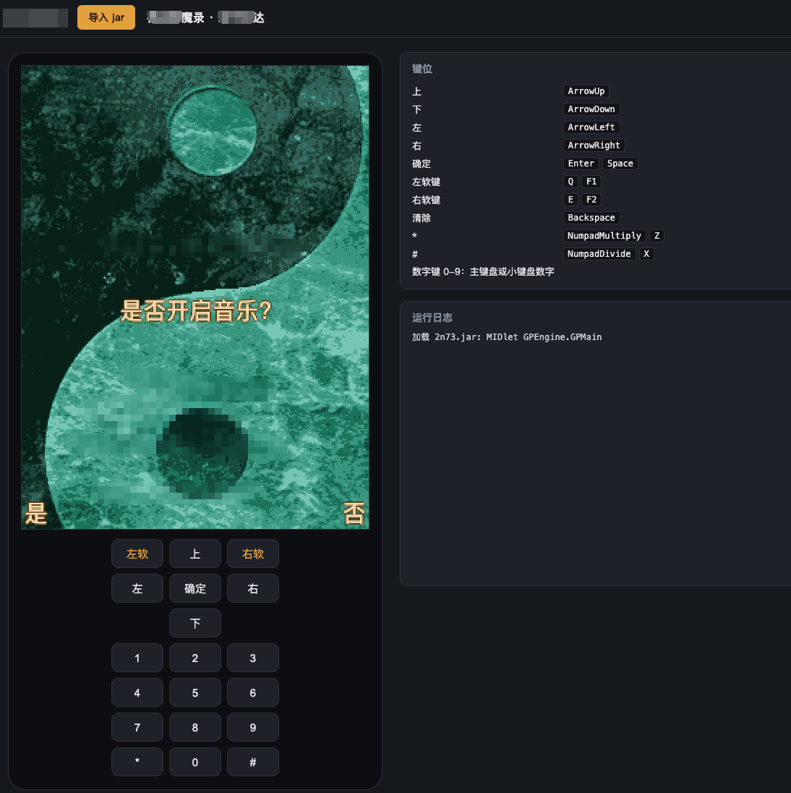

# JarGame

在浏览器里运行 J2ME（MIDP 2.0 / CLDC 1.1）手机游戏的模拟器。

JarGame 用 TypeScript 从零实现了一个 Java 字节码解释器，并配套一份用 Java 编写的 CLDC / MIDP 平台类库。不依赖 Java 插件、WebAssembly 或服务端，打开网页、拖入 `.jar` 即可运行。



## 项目方向

- **开箱即用**：纯前端、零安装，桌面和移动端浏览器都能直接玩功能机时代的 Java 游戏。
- **兼容性优先**：目标是覆盖绝大多数 MIDP 2.0 游戏，包括大量依赖 Nokia / Samsung 厂商扩展 API、GBK 编码的中文游戏。
- **可验证的正确性**：VM 行为通过与真实 JVM 对比输出的一致性测试来约束，兼容性通过批量跑游戏的自动化测试来度量。
- **可嵌入**：模拟器核心（`Emulator`）与 UI 分离，渲染与存储均可替换，也可以在 Node 中无头运行。

## 当前状态

项目处于**早期阶段**，第一阶段（内核兼容性）仍在进行，第二阶段的键位、存档、金手指和内购破解已经可用。API 和存档格式都可能变化。

在 2301 个真实游戏 jar 组成的测试集上，**2184 个（94.9%）通过首帧测试**，即 4 秒内启动并输出 10 帧以上画面。

其余游戏还不能正常运行，原因包括：

- 运行时异常
- CPU 占满但不出画面
- 检测平台属性后主动退出
- 依赖暂不支持的 3D API

另有一部分游戏没有报错，只是出帧慢，延长等待后大多能正常显示。以上问题会按 [ROADMAP](#roadmap) 逐步处理。

## ROADMAP

### 第一阶段：Web J2ME 游戏内核

目标是让大部分 jar 游戏能导入试玩。

**虚拟机**

- [x] class 文件解析与完整字节码解释器
- [x] 异常处理、`synchronized` / `wait` / `notify`、`long` 以 `BigInt` 精确实现
- [x] 协作式多线程调度：按时间片运行，不阻塞浏览器主线程
- [x] 与真实 JVM 逐行对比输出的一致性测试
- [ ] 解释器性能优化，保证中低端移动设备也能满帧运行

**平台类库**

- [x] CLDC 1.1：`java.lang`、`java.io`、`java.util` 常用类，支持 UTF-8 / GBK / UTF-16 等字符集
- [x] MIDP 2.0 低级 UI：`Canvas`、`Graphics`、`Image`、`Font`
- [x] MIDP 2.0 高级 UI：`Form` / `List` / `Alert` / `TextBox`，以 HTML 浮层呈现
- [x] `lcdui.game`：`GameCanvas`、`Sprite`、`TiledLayer`、`LayerManager`
- [x] RMS：`RecordStore`，按游戏持久化到浏览器 `localStorage`
- [x] Nokia UI API（`FullCanvas`、`DirectGraphics`、`DeviceControl`、`Sound`）、Samsung API（`AudioClip`、`SMS` 等）
- [x] MMAPI `Player` 状态机、GCF 网络（空实现，游戏调用不会报错）
- [x] WMA 短信（`sms://`）与 Samsung `SMS`：不真正发送，交给宿主的计费拦截决定成功或失败
- [ ] 音频输出：MIDI（WebAssembly 合成器 + 音色库）、WAV（Web Audio）、`ToneControl`；Nokia `Sound`、Samsung `AudioClip` 接入同一后端
- [ ] 可选 API：蓝牙（JSR-82）、PIM、FileConnection、传感器
- 3D（M3G、Mascot Capsule）暂不在计划内

**兼容性**

- [x] 批量兼容性测试，按失败原因自动汇总报告；样本中约 95% 能出画面
- [ ] JAD 支持：属性合并进 `MIDlet.getAppProperty`（部分游戏因读取只在 JAD 中声明的属性而报错）
- [ ] 容错 zip 解析：兼容 data descriptor、非常规 flags 等不规范的 jar
- [ ] 排查 CPU 占满但几乎不出画面的游戏（疑似线程调度或绘制同步死锁）
- [ ] 排查检测平台属性后主动退出的游戏
- [ ] 逐个修复剩余运行时异常，使样本中能出画面的比例达到 98% 以上
- [ ] 抽样人工验证可玩性（进入关卡、操作、存档），而不只是能出画面

### 第二阶段：Web 模拟器体验

在内核之上补齐模拟器常用功能。

**基础交互**

- [x] 拖放或选择文件导入 jar，支持 `?jar=` URL 参数加载
- [x] 键盘与屏幕虚拟键盘输入，触摸 / 鼠标映射为指针事件
- [x] 运行日志面板，实时显示 FPS、指令速率与线程数
- [ ] 暂停 / 继续（平台层已能处理暂停 / 恢复事件并回调 `pauseApp` / `startApp`，界面未接入）
- [ ] 机型与分辨率选择（176×208、240×320、360×640 等）、横屏、画面缩放（内核已支持自定义分辨率，界面固定为 240×320）
- [ ] 移动端适配：响应式布局、全屏、手柄
- [ ] 本地游戏库：已导入游戏列表、图标与最近游玩（IndexedDB）

**键位与存档**

- [x] 键位映射自定义，按游戏保存
- [x] RMS 存档导入导出
- [x] 即时存档 / 读档：序列化堆、线程栈与 native 对象（含图片像素），4 个存档槽，可导出为文件

**增强功能**

- [x] 游戏加速 / 减速：调节虚拟机时钟（0.5×–4×，按游戏保存）
- [x] 金手指：内存数值搜索、修改与锁定，金手指码保存与分享
- [x] 内购破解：拦截短信计费（WMA、Samsung `SMS`）并模拟支付成功，`platformRequest` 只记录
- [ ] 游戏录制：截图、录制视频（WebM / GIF）、按键录制与回放

### 第三阶段：在线体验网站

提供一个可直接访问的在线版本，自带少量示例游戏。

- [x] 可构建为纯静态站点（`npm run build`），支持部署在子路径下
- [ ] 自动构建与部署（GitHub Actions + GitHub Pages 或同类服务）
- [ ] 挑选版权明确的示例游戏（开源、自制或已获授权）并随站点内置
- [ ] 示例游戏列表页：封面、简介、键位说明、一键启动
- [ ] 加载性能：`rt.jar` 与游戏资源的缓存和按需加载
- [ ] PWA 离线可用，可添加到手机主屏幕
- [ ] 使用说明与常见问题页面

## 快速开始

需要：

- Node.js 22+
- JDK（`javac` 和 `java` 在 `PATH` 中）。平台类库 `rt/src` 在构建时以 `-source 8 -target 8` 编译成 `public/rt.jar`，测试时也需要用 `java` 生成对照输出。已在 JDK 21 上验证。

```bash
npm install
npm run dev
```

打开终端输出的地址，把 `.jar` 拖到屏幕区域，或点击「导入 jar」。

也可以通过 URL 参数直接加载：`/?jar=<jar 的 URL>`。开发时如果想加载本地目录里的游戏，可以用 `JAR_DIR` 把目录暴露给开发服务器：

```bash
JAR_DIR=/path/to/games npm run dev
# 然后访问 http://localhost:5173/?jar=/@fs/path/to/games/xxx.jar
```

构建静态站点：

```bash
npm run build   # 产物在 dist/
```

### 默认键位

可在右侧「键位」面板修改：点击「+」后按下键盘按键即可绑定，点击已绑定的按键可移除。修改按游戏单独保存；未加载游戏时修改的是所有游戏的默认键位。

| 手机按键 | 键盘 |
|---|---|
| 方向键 | 方向键 |
| 确定 | Enter / Space |
| 左软键 | Q / F1 |
| 右软键 | E / F2 |
| 清除 | Backspace |
| `*` / `#` | Z / X（或小键盘 `*` / `/`） |
| 数字 0-9 | 主键盘或小键盘数字 |

### 存档

「存档」面板提供两种存档：

- **即时存档**：保存游戏此刻的完整运行状态（虚拟机堆、线程栈、画面、图片像素和 RMS），读档后从那一刻继续，不依赖游戏自己的存档功能。每个游戏 4 个槽位，保存在浏览器 IndexedDB 中，也可以导出为 `.jgs` 文件再读取。
- **RMS 存档**：游戏自己通过 `RecordStore` 写入的存档，自动保存在 `localStorage`。可导出为 JSON 备份或迁移到其他浏览器，导入后游戏会重启。

存档、键位和金手指都按游戏的 `MIDlet-Name` 与 `MIDlet-Vendor` 区分，与 jar 文件名无关。

### 金手指

「金手指」面板用来搜索和修改游戏内存中的数值，用法与 Cheat Engine 类似：

1. 输入当前数值（如金币 1200）进行首次搜索；不知道具体数值时选「未知初值」。
2. 让数值在游戏里发生变化，再用新数值（或「变大了 / 变小了 / 变化了 / 没变」）继续搜索，直到剩下少量结果。
3. 在结果里直接改值，或「加入金手指」。金手指可以勾选「锁定」，让模拟器持续写入该值。

金手指用从静态字段出发的路径定位数值（如 `com/foo/Game.inst:Lcom/foo/Game;.player:Lcom/foo/Player;.hp:I`），重启游戏或读档后依然有效。每行一条 `名称 | 数值 | 路径 [| lock]` 的文本格式，可复制分享、粘贴导入。

### 内购破解

很多国产 J2ME 游戏通过发送扣费短信购买关卡或道具。模拟器不会真正发送任何短信：「内购」面板开启时（默认开启），WMA `MessageConnection.send` 和 Samsung `SMS.send` 向游戏返回发送成功；关闭时表现为发送失败。每次计费请求的号码和内容都会列在面板和运行日志里。`platformRequest`（打开网页、拨号等）只记录、不执行。

## 测试

```bash
npm test
```

会依次编译平台类库、编译 `tests/java` 下的 Java 测试程序，并运行：

- **一致性测试**（`tests/conformance.test.ts`）：同一份 Java 程序分别在真实 JVM 和 JarGame 中运行，逐行比对输出。新增 VM 用例时，在 `tests/java/<name>/Main.java` 下加一个目录即可。
- **存档测试**（`tests/snapshot.test.ts`）：同样的 Java 程序，每个调度时间片都存档、恢复到一个全新的模拟器再继续运行，输出仍须与真实 JVM 逐行一致。
- **金手指测试**（`tests/cheats.test.ts`）与**内购测试**（`tests/billing.test.ts`）：后者的 Java 程序放在 `tests/midp/<name>/`，用到桌面 JVM 没有的平台 API，只编译、不生成对照输出。
- **游戏冒烟测试**（`tests/game.test.ts`）：指定 `GAME_JAR` 时无头运行该游戏，检查无未捕获异常且能输出至少 30 帧；未指定时跳过。

  ```bash
  GAME_JAR=/path/to/game.jar npx vitest run tests/game.test.ts
  # 卡住时加 DUMP_STACKS=1 打印各线程调用栈
  ```

### 批量兼容性测试

对一个目录里的所有 jar 做无头启动测试，并按失败原因汇总报告：

```bash
# 默认随机抽样 60 个；COMPAT_SAMPLE=all 跑全部，COMPAT_SHARD=i/n 可分片并行
# COMPAT_SNAPSHOT=1 时，出画面的游戏还会被存档、恢复到新模拟器，并要求恢复后继续出帧
COMPAT_DIR=/path/to/games COMPAT_SAMPLE=all COMPAT_OUT=build/compat/results.jsonl \
  npx vitest run tests/compat.test.ts

node scripts/compat-report.mjs build/compat/results.jsonl --out build/compat/report.md
```

扫描一批 jar 引用了哪些平台类库中尚未实现的 API：

```bash
node scripts/api-usage.mjs /path/to/games [--prefix com/nokia/]
```

## 项目结构

```
src/
  vm/            JVM：class 文件解析、解释器、线程调度、java.lang 的 native 实现
  midp/          MIDP 平台的宿主侧：事件、图形（Canvas 2D）、RMS 存储
  emulator.ts    组装 VM 与平台，读取 jar manifest，对外的嵌入入口
  snapshot.ts    即时存档：整个 VM 与平台状态的序列化 / 恢复
  cheats.ts      金手指：堆内存数值搜索、地址路径、锁定
  keymap.ts      键位映射与按游戏保存
  main.ts        Web UI 入口
  ui/            各个侧边面板（键位、存档、金手指、内购）
rt/src/          平台类库的 Java 源码（java.*、javax.microedition.*、厂商扩展），
                 与 TypeScript 宿主通过 native 方法桥接（jargame.Host）
scripts/         构建 rt.jar、生成测试对照输出、兼容性报告、API 缺口扫描
tests/           一致性、存档、金手指、内购测试，游戏冒烟测试，批量兼容性测试
```

平台类库主要用 Java 实现，和游戏代码一样由解释器执行，只有图形、输入、存储等必须接触浏览器的部分才以 native 方法交给 TypeScript。这样大部分 MIDP 行为可以直接按规范用 Java 编写，宿主侧保持精简。

## 声明

本项目不包含任何游戏文件。请仅运行你拥有合法使用权的软件。J2ME、Java 是 Oracle 的商标；Nokia、Samsung 等名称归各自所有者所有。

## 许可证

[GPL-3.0-or-later](LICENSE)
